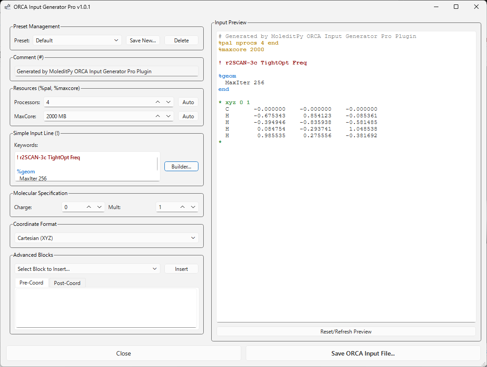
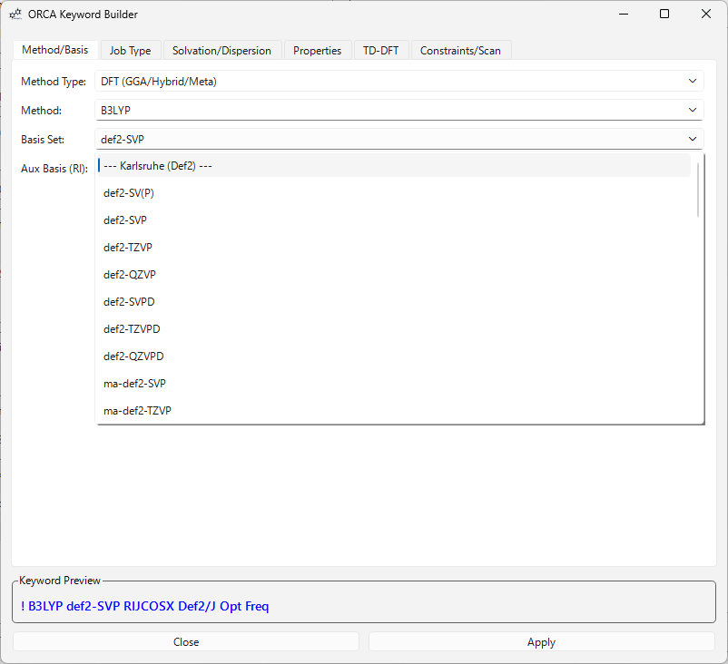
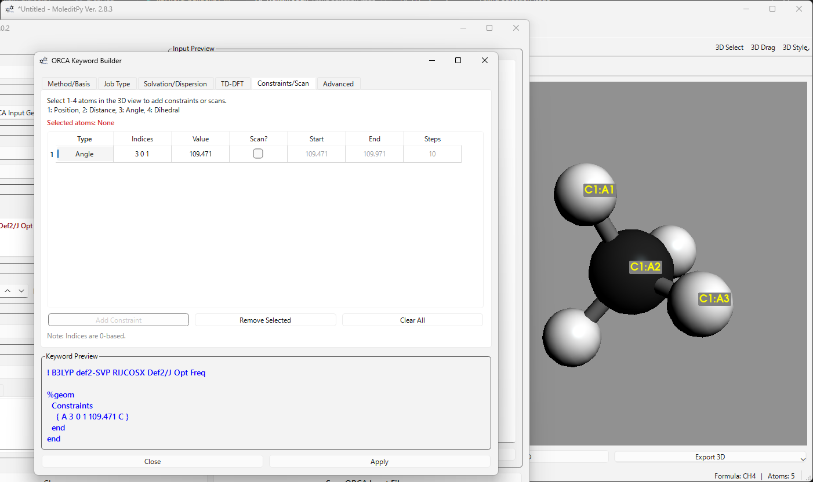

# MoleditPy ORCA Input Generator Pro

## Loading existing inputs

`.inp` files are registered with MoleditPy's file-opener registry and
drag-and-drop handlers (priority 100). Open them through the generated File > Import
entry, launch MoleditPy with an input path, or drop a file onto the main window.
Drops open the generator after the native drop event finishes; unrelated input
formats and binary files are declined.

Use **File > Import > ORCA Input...** (also available
without a molecule loaded), or **Load Input File...** in the generator.
ORCA `.inp` files are displayed verbatim in the editable
Preview. Supported Job 1 conditions are recovered into the form, including
resources, keywords, charge and multiplicity. Cartesian and ordinary Z-matrix
coordinates can be displayed in 3D; ORCA external XYZ paths resolve relative to
the input file. Unsupported syntax is retained as text with an explanatory
notice. Additional jobs, custom blocks and unknown commands remain in Preview.

Imported or directly edited text takes priority over generated settings.
While that text is authoritative, the form is read-only. **Recover Conditions
from Text** updates the recovered fields and structure without regenerating
the input. **Reset/Refresh Preview** explicitly returns to generation from
the recovered settings and current structure; it can discard commands that
the form cannot represent.

Project files store a single optional `input_text` string only when Preview
differs from the generated snapshot, or imported charge/spin cannot be
reconstructed from the displayed coordinate-only molecule. Direct edits and complex imported text
therefore survive a `.pmeprj` save/reopen. Normal generation, reverting to the
generated text and Reset/Refresh omit this extra field. Loading and editing do
not write the source input file; saving requires Save or Ctrl+S.

Generated charge/multiplicity selections are retained with the molecule's
charge signature, so changing the molecule invalidates stale selections.
External XYZ filenames and resource values outside the initial form ranges
also survive project reopening. Restoring saved input text preserves the
project molecule; only explicit input import or Recover Conditions replaces
its structure. Input export stages the complete text before replacing an
existing file, keeping the previous file if writing fails.

Automatic file references chosen by Save As survive project reopening
without storing an extra full-text copy. Out-of-range resource, charge and
spin integers remain in authoritative input text without being passed to Qt
widgets that cannot represent them.

If an input editor remains open after the host resets its document, its
unsaved text is retained in a detached editor. It cannot modify the next
project's molecule or saved input; opening the generator creates a separate
editor for the new project.

An advanced **ORCA Input Generator** plugin for **MoleditPy**, designed to streamline the creation of high-quality ORCA 5/6 calculation input files with a focus on usability, automation, and interactive 3D tools.

Repo: [https://github.com/HiroYokoyama/moleditpy_orca_input_generator_pro](https://github.com/HiroYokoyama/moleditpy_orca_input_generator_pro)

---

## Key Features

- **Comprehensive Keyword Builder** — tabbed GUI covering methods, job types, solvation, dispersion, TD-DFT, constraints, and all advanced options
- **Real-time Preview** — generated keyword line and full `.inp` file update instantly as you make changes
- **Round-trip Parsing** — open an existing `.inp` file and all settings are restored into the UI
- **Interactive Constraints & Scans** — click atoms in the MoleditPy 3D viewer to define distance/angle/dihedral constraints or coordinate scans
- **22 Block Templates** — one-click insertion of annotated `%block ... end` stubs for every major ORCA block
- **Job Manager Relay Tag** — tick a box to fill the `* xyzfile` filename with a configurable tag (`[prevfile:.xyz]` by default) instead of a literal filename; the Job Manager plugin resolves it to the real geometry from whichever job you pick when this input is submitted. The tag text is editable and can be saved as the default for new documents
- **Syntax Highlighting** — `.inp` files get colour-coded keywords, blocks, and resource headers
- **Session Persistence** — last-used settings are saved and restored between sessions
- **599 automated tests** across all features

---

## Job Types

| Job | ORCA keyword |
|-----|-------------|
| Single Point | *(default)* |
| Geometry Optimisation | `Opt` |
| Frequency | `Freq` |
| Opt + Freq | `Opt Freq` |
| Gradient (SP + forces) | `EnGrad` |
| Numerical Gradient | `NumGrad` |
| Numerical Hessian | `NumHess` |
| Transition State | `OptTS` |
| IRC | `IRC` |
| NMR | `NMR` |
| Vibronic Absorption | `ESD(ABS)` |
| Vibronic Fluorescence | `ESD(FLUOR)` |
| Gradient (general) | `Gradient` |
| Hessian (general) | `Hessian` |

---

## Supported Methods

### DFT
- **GGA**: BLYP, BP86, PBE, revPBE, OLYP, …
- **Hybrid**: B3LYP, PBE0, TPSSh, B3PW91, CAM-B3LYP, ωB97X-D3, M06-2X, …
- **Meta-GGA / meta-Hybrid**: TPSS, M06-L, r2SCAN, …
- **Double Hybrid**: B2PLYP, RI-B2PLYP, PWPB95, …
- **3c composites**: B97-3c, r2SCAN-3c, HF-3c

### Wavefunction
- HF, MP2, RI-MP2
- CCSD, CCSD(T)
- DLPNO-MP2, DLPNO-CCSD(T), DLPNO-CCSD(T1)
- DLPNO-CCSD(T)-F12 with CABS basis
- CASSCF, NEVPT2, MRCI, MR-MP2

### Relativistic
- ZORA, IORA, DKH2, X2C (via `%rel` block)

### PNO Control
- LoosePNO / NormalPNO / TightPNO

---

## Basis Sets & Auxiliary Bases

- def2-SV(P), def2-SVP, def2-TZVP, def2-TZVPP, def2-QZVPP
- cc-pVDZ/TZ/QZ, aug-cc-pVDZ/TZ, cc-pVDZ-F12, cc-pVTZ-F12
- Pople 6-31G(d), 6-311+G(d,p), …
- Aux: Def2/J, Def2/JK, cc-pVDZ-F12-CABS, cc-pVTZ-F12-CABS
- Custom MOREAD (MO file path parsed from/to route)

---

## SCF Options

| Feature | Details |
|---------|---------|
| Convergence threshold | SloppySCF → ExtremeSCF |
| Damping | SlowConv, VerySlowConv |
| Initial guess | Default / PModel / Hueckel / HCore / PAtom / MOREAD |
| RI approximation | RIJCOSX, RI |
| Chain-of-spheres exchange | COSX (without RI Coulomb) |
| Broken-symmetry DFT | UKS + `%scf BrokenSym n,m end` |

---

## Properties

| Property | Keyword |
|----------|---------|
| Natural Bond Orbital | NBO |
| Natural Population Analysis | NPA |
| ChElPG charges | ChElPG |
| Hirshfeld / CM5 charges | Hirshfeld |
| Uncoupled MOs | UCO |
| Natural UHF orbitals | UNO |
| Singly-occupied MOs | SOMO |
| Fractional occupation density | FOD |
| Optical rotation | OptRot |
| Polarizability | Polarizability |
| Hyperpolarizability | Hyperpol |
| EPR parameters | EPR |
| Zero-field splitting | ZFS |
| Spin-orbit coupling integrals | RI-SOMF(1X) |
| No RI in properties | NoRI |
| FrozenCore / NoFrozenCore | FrozenCore / NoFrozenCore |
| Print level | LargePrint / MiniPrint / PrintBasis |
| File retention | KeepDens / KeepInts |

---

## TD-DFT

- Number of roots, target root (IRoot)
- Triplet states toggle
- Tamm-Dancoff Approximation (TDA)
- VCD (`doVCD true`) and ROA (`doROA true`) via `%freq` block

---

## Solvation & Dispersion

- **Implicit solvation**: CPCM, SMD (with solvent selection)
- **Dispersion corrections**: D2, D3BJ, D3Zero, D4, NL

---

## Block Templates

One-click insertion of annotated templates for all 22 major ORCA blocks:

`%output` · `%eprnmr` · `%scf` · `%geom` · `%elprop` · `%plots` · `%tddft` · `%cis` · `%rocis` · `%mrci` · `%casscf` · `%mdci` · `%neb` · `%md` · `%compound` · `%basis` · `%cpcm` · `%rel` · `%mp2` · `%dft` · `%frag` · `%freq` · `%loc` · `%esd`

Each template includes inline comments explaining every sub-keyword and common options.

---

## Interactive Constraints & Scans

1. Open the **Constraints/Scan** tab in the Keyword Builder.
2. Click atoms in the MoleditPy 3D viewer:
   - **1 atom** → position constraint
   - **2 atoms** → distance constraint/scan
   - **3 atoms** → angle constraint/scan
   - **4 atoms** → dihedral constraint/scan
3. Selected atoms are highlighted with labels in the 3D scene.
4. Click **Add Constraint** to insert into the table.
5. Check the **Scan?** column and set Start/End/Steps to run a coordinate scan.

The plugin generates the correct `%geom Constraints ... end` and `%geom Scan ... end` blocks automatically.

---

## Installation

1. Ensure MoleditPy is installed.
2. Download the plugin from the [MoleditPy Plugin Explorer](https://hiroyokoyama.github.io/moleditpy-plugins/explorer/?q=ORCA+Input+Generator+Pro) into your MoleditPy plugins directory.
3. Restart MoleditPy — **ORCA Input Generator Pro** will appear in the Plugins menu.

---

## Usage

1. Open a molecule in MoleditPy.
2. Launch **ORCA Input Generator Pro** from the Plugins menu.
3. Configure your calculation in the tabbed settings panel.
4. Review the **Input Preview** on the left — it updates in real time.
5. Click **Save ORCA Input File…** to write the `.inp` file.

To load an existing input file: use **Open…** and all settings will be restored from the file.

---

## Dependencies

- **PySide6** — graphical interface
- **RDKit** — molecular geometry and property handling
- **NumPy** — coordinate calculations

---

## License & Disclaimer

Licensed under the GNU Lesser General Public License v3.0 — see [LICENSE](LICENSE) for details.
Provided *as is* without warranty. Users are responsible for validating outputs before use in publications or production workflows. Please [open an issue](https://github.com/HiroYokoyama/moleditpy_orca_input_generator_pro/issues) if you find a bug.

## Licensing scope

First-party code in this migration is LGPL-3.0-or-later. See [LICENSE](LICENSE), [COPYING](COPYING) and [dependency/provenance terms](LICENSING.md). Third-party components and historical releases retain their own terms.

## Input correctness audit (2026-10-24)

Generated coordinates honor each job's explicit length/angle units. Loading an
input and refreshing it preserves ghost-atom identity and physical bond lengths.
Builders retain omitted/default basis choices rather than injecting their own
default basis into an existing input. The complete imported/edited text remains
authoritative until Reset/Refresh.

The initial Hessian control emits `%geom Calc_Hess true`, and numerical
frequencies do not depend on whether the builder is visible. MD, fragment and
Compound templates follow the ORCA manual syntax; example geometries, fragment
indices and run lengths still need to be adapted to the calculation.

See [the audit record](docs/INPUT_AUDIT.md) for sources and validation limits.
